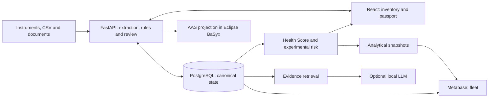

# PassportTwin

**A digital passport for instrument traceability and condition monitoring.**

Master's Final Project in Industry 4.0 · Universitat Politècnica de Catalunya (UPC) · 2026

Developed by **[Alexander Castillo](https://github.com/alexanderj-castillo)** and **[Pau Modolell](https://github.com/paumr90)**.

**Status as of 24 November 2026: academic MVP completed.** The platform integrates inventory, passports, certificate review, calibration history, audit trails, AAS projections and condition indicators. The agreed EXP-01–07 evaluation is complete within the scope and limitations described below. The Master's thesis has been submitted. This milestone does not imply metrological certification, industrial validation or the availability of a commercial service.

[Getting started](#getting-started) · [Results](docs/experiments/mvp-final-results.md) · [Operations and environments](docs/mvp-operation.md) · [Dashboard](bi/README.md) · [Next steps](#limitations-and-next-steps)

## The problem it addresses

Instrument identity, certificates and history are often scattered across files and applications. PassportTwin brings this information together in a searchable passport and preserves the relationship between the original document, reviewed data and asset state.

A complete workflow allows an operator to find an instrument with an overdue calibration, upload a certificate, detect an identity mismatch, correct the data through human review and record the new calibration. The passport reflects the updated history; the audit trail makes it possible to reconstruct the correction and ingestion without modifying the original PDF.

The pilot contains **16 synthetic instruments**: eight pressure transmitters (PT-101–108), four temperature probes (TT-201–204) and four pH electrodes (PH-301–304). It covers overdue calibration, document review, insufficient history, maintenance, incidents and retirement. These are demonstration cases, not a validated industrial fleet.

## Implemented capabilities

| Area | Available functionality |
| --- | --- |
| Home and inventory | Search by name, plant tag, serial number or location; location groups, filters and prioritization by calibration status. |
| Passport | Identity, manufacturer, location, operational state, calibration, Health Score and risk; separate history views with navigation back to the summary. |
| Documents | Upload and processing, original PDF viewer and download, extraction, review, correction, revalidation and explicit ingestion into the history. |
| Traceability | SHA-256, extracted and reviewed values, audit events and change inspection. A hash supports integrity checks; it does not by itself establish issuer authenticity. |
| Lifecycle | Calibrations, maintenance and incidents. Calibration validity is distinguished from operational state and metrological results. |
| Interoperability | Four AAS submodels in Eclipse BaSyx and reconstruction from canonical state; an experimental AASX exchange tool. |
| Access | Stable public UUID and QR/label download. Instrument photo support; the latest revision simplifies the passport header. |
| Analytics | Explainable Health Score, experimental risk at 30/60/90 days and reference methods for drift evaluation. |
| Fleet dashboard | Metabase indicators, priorities, deadlines, filters, passport links and freshness checks for saved results. |
| Document AI | Assisted extraction and queries with evidence retrieval; optional integration with a local server compatible with `llama.cpp`. |

Passing document rules and **adding a calibration to the history are separate steps**. Document validation does not provide metrological certification of the instrument. Ingested documents are read-only in the review workflow.

## Architecture and RAMI 4.0 approach

RAMI 4.0 provided a framework for organizing the relationship between the physical asset, integration, communication, information, functions and operational use. The layered organization is a design choice informed by that framework; it is not a certification of compliance.



**PostgreSQL is the source of truth.** BaSyx holds a reconstructible projection. `POST /api/v1/instruments/{id}/sync` rebuilds `Nameplate`, `OperationalState`, `CalibrationHistory` and `DocumentProvenance`; `SYNCED` requires all four projections to complete.

`Nameplate` uses an external semantic reference. The other three submodels use MVP-specific identifiers: they are not standardized IDTA templates. The evaluated exchange uses AAS v2 and an explicit profile of critical entries.

The implementation combines **Python/FastAPI, PostgreSQL, React/Vite, Eclipse BaSyx, Metabase and Docker Compose**. It does not include continuous sensor acquisition or automatic control of the physical instrument.

## Interpreting the indicators

### Calibration and Health Score

The passport distinguishes overdue calibration, calibration due soon, current calibration and missing history. The lifecycle Health Score combines configurable penalties: calibration status (30%), estimated risk (30%), recent incidents (20%) and data quality (20%). These are default weights, not a metrological standard. If a required component is missing, the result is reported as not calculable.

The passport contract is `GET /api/v1/instruments/{id}/health-score`. The legacy predictions endpoint retains a different analytical contract and must not be confused with this Health Score.

### Experimental risk

The model fits a linear error trend and a Gaussian approximation of predictive uncertainty. It estimates the probability of exceeding tolerance **at the target dates** 30, 60 and 90 days ahead, not the cumulative probability of any failure during the interval. After maintenance, it uses subsequent history and may abstain when data is insufficient.

An instrument can have overdue calibration and low estimated risk. A new calibration may improve the Health Score without changing the rounded risk shown on screen. A displayed 0.0% does not guarantee the absence of risk.

### Passport and Metabase

The passport calculates using the data available at query time. Metabase also uses persisted snapshots: changing canonical data does not automatically refresh every saved analytical result. Freshness states distinguish current, missing and stale results.

Contracts: [Health Score](docs/architecture/lifecycle-health-v2.md), [risk](docs/architecture/tolerance-risk.md) and [snapshots](docs/architecture/analytics-snapshots.md).

## MVP evaluation

The seven experiments were completed using synthetic data and a practical traceability check. Completion describes the work performed; it does not mean every model met every comparative criterion.

| Experiment | Result and main limitation |
| --- | --- |
| EXP-01 · Extraction | 168/168 matches across 24 PDFs in three synthetic layouts, including six expected missing values. Evaluates the deterministic extractor, not general OCR/LLM performance. |
| EXP-02 · Matching | 18 correct links and nine correct abstentions across 27 cases; ambiguous identities sent for review. |
| EXP-03 · Rules | Expected rules in all 24 PDFs and two supplementary checks passed: hash-based duplicates and out-of-tolerance acceptance. |
| EXP-04 · Drift | Overall normalized MAE of 0.285 versus 0.329 for the baselines. Improved at 60/90 days and worsened at 30 days. |
| EXP-05 · Risk | Paired Brier score of 0.108 versus 0.154; estimation coverage of 87.5%. Nominal 95% intervals covered 77.7% of scored observations. |
| EXP-06 · AASX | 129/129 and 43/43 critical entries preserved in the two cases at every evaluated boundary. Does not certify universal interoperability. |
| EXP-07 · Traceability | CERT and TRACE completed according to the participant record. Estimated times below 3 and 5 minutes; no exact timing or formal usability comparison. |

The [evaluation report](docs/experiments/mvp-final-results.md) identifies provenance, scope and limitations. These results belong to the revisions recorded during evaluation, not to a new run against the latest commit. AI capabilities added later do not automatically inherit that validation.

## Getting started

Requirements: Git, Docker with Compose v2 supporting `up --wait`, and Python 3.10+ for the launcher. Application dependencies run in containers.

```powershell
git clone https://github.com/projects-i40-ap/passporttwin.git
cd passporttwin
py tools/dev.py start
```

On Linux/macOS, replace `py` with `python3`. `start` creates `.env` from `.env.example` only if it does not exist, starts PostgreSQL, applies the identity/model migrations, prepares Metabase's internal database and builds/starts the services. BI views are installed separately following their guide.

| Service | Default local URL |
| --- | --- |
| Application | http://localhost:5173 |
| API / OpenAPI | http://localhost:8000/docs |
| Metabase | http://localhost:3003 |

Review `.env` before starting if different ports or URLs are needed. Do not publish credentials. Check startup with `docker compose ps`.

### Choosing demonstration data

- **16-instrument pilot:** follow [MVP operations](docs/mvp-operation.md), install the views and run the pilot generator only in an isolated environment with an explicit reference date.
- **Minimal four-instrument demo:** `py tools/dev.py demo` prepares views, creates `PTWIN-DEMO-*` and their snapshots. This is an alternative; it is not required for the 16-instrument pilot. Running it on the pilot adds the four cases to the inventory.

The generators preserve existing records and are not restore commands. They do not automatically advance the dates of cases that already exist.

### Dashboard and optional AI

Metabase requires initial setup, a data connection and card provisioning: [instructions](bi/README.md). Starting containers does not install the dashboard by itself. Its ID depends on the instance.

Local AI is optional and disabled by default through `AI_LEGO_ENABLED`. It requires server/model configuration in `.env`. Queries retrieve evidence and, if the model is unavailable, can return it without a generated answer (`OFFLINE_RETRIEVAL_ONLY`). See [.env.example](.env.example), [configuration](backend/app/core/config.py) and the [query service](backend/app/services/rag_service.py). Compatibility with every model or correct interpretation of every PDF is not guaranteed.

### Checks

Run tests against a disposable database, never against demonstration data that must be preserved. See [backend tests](backend/tests/README.md), [BI](bi/README.md) and [.github/workflows](.github/workflows). Historical reports describe specific runs, not a permanent count of passing tests.

## Limitations and next steps

The MVP is complete within its academic scope. Industrial deployment requires:

- Evaluation with real certificates and histories, varied formats, OCR and local models; probability calibration and a formal usability study.
- Authentication, authorization, secret management, secure deployment and observability appropriate to the target environment.
- Verified AAS persistence and recovery: BaSyx uses in-memory storage in development; PostgreSQL retains canonical state.
- Synchronization retries, joint restoration of the database and original files, and concurrency tests for document ingestion.
- Closer alignment with standardized semantic templates and maintenance of the legacy AASX experimental environment.
- Validation of reuse and refurbishment criteria. The circularity recommendation engine is future work, not a completed feature.

The [historical technical debt register](docs/technical-debt.md) preserves development findings. Its statuses must not be mistaken for a fully revalidated inventory of current defects.

## Collaborative development and AI use

Both authors worked through Git/PR and change review, with AI assistance for design, implementation and checks. Proposals are checked against code, tests and reports: a generated response is not validation evidence.

The project distinguishes **AI incorporated into the product**, including document assistance and analytical models, from **AI used during development**, under human decision-making and review. The methodology and lessons learned form part of the thesis. [Contribution guide](CONTRIBUTING.md).

## Repository structure

| Directory | Contents |
| --- | --- |
| `backend/` | API, canonical models, services, scripts and tests. |
| `frontend/` | React/Vite application. |
| `bi/` | SQL views and Metabase provisioning. |
| `experiments/` | Protocols, evaluators, fixtures and selected results. |
| `ai/` | Analytical development and model resources. |
| `infra/` | PostgreSQL schema and migrations. |
| `tools/` | Local startup utilities. |
| `docs/` | Architecture, operations, evaluation and historical checkpoints. |

## Authors and license

**Alexander Castillo** and **Pau Modolell Rodríguez** · Master's Final Project in Industry 4.0, UPC.

Copyright © 2026. **All rights reserved.** Shared for academic review, demonstration and portfolio purposes. Reuse, modification, redistribution or commercialization require written permission from both authors under [LICENSE](LICENSE). Publishing the code does not grant an open-source license or establish that a patent has been granted.
