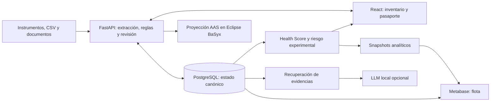

# PassportTwin

**Pasaporte digital para la trazabilidad y el seguimiento del estado de instrumentos.**

Trabajo de Fin de Máster en Industria 4.0 · Universitat Politècnica de Catalunya (UPC) · 2026

Desarrollado por **[Alexander Castillo](https://github.com/alexanderj-castillo)** y **[Pau Modolell](https://github.com/paumr90)**.

**Estado a 24 de noviembre de 2026: MVP académico completado.** La plataforma integra inventario, pasaportes, revisión de certificados, historial de calibración, auditoría, proyección AAS e indicadores de estado. La evaluación acordada EXP-01–07 está cerrada con el alcance y las limitaciones descritos abajo. La memoria del TFM ha sido entregada. Este cierre no supone certificación metrológica, validación industrial ni disponibilidad de un servicio comercial.

[Puesta en marcha](#puesta-en-marcha) · [Resultados](docs/experiments/mvp-final-results.md) · [Operación y entornos](docs/mvp-operation.md) · [Dashboard](bi/README.md) · [Próximos pasos](#límites-y-próximos-pasos)

## Qué resuelve

La identidad de un instrumento, sus certificados y su historial suelen quedar repartidos entre archivos y aplicaciones. PassportTwin reúne esa información en un pasaporte consultable y conserva la relación entre el documento original, los datos revisados y el estado del activo.

Un recorrido completo permite localizar un instrumento con calibración vencida, incorporar un certificado, detectar una discrepancia de identidad, corregir el dato mediante revisión humana y registrar la nueva calibración. El pasaporte refleja el historial actualizado; la auditoría permite reconstruir la corrección y la incorporación sin modificar el PDF original.

El piloto contiene **16 instrumentos sintéticos**: ocho transmisores de presión (PT-101–108), cuatro sondas de temperatura (TT-201–204) y cuatro electrodos de pH (PH-301–304). Incluye vencimiento, revisión documental, historial insuficiente, mantenimiento, incidencias y retirada. Son casos de demostración, no una flota industrial validada.

## Funcionalidades implementadas

| Área | Funcionalidad disponible |
| --- | --- |
| Inicio e inventario | Búsqueda por nombre, etiqueta, serie o ubicación; agrupación por ubicación, filtros y prioridad por estado de calibración. |
| Pasaporte | Identificación, fabricante, ubicación, estado operativo, calibración, Health Score y riesgo; vistas separadas para los historiales y regreso al resumen. |
| Documentos | Carga y procesamiento, visor y descarga del original, extracción, revisión, corrección, revalidación e incorporación explícita al historial. |
| Trazabilidad | SHA-256, valores extraídos y revisados, eventos de auditoría y consulta de cambios. El hash permite comprobar integridad; no acredita por sí solo la autenticidad del emisor. |
| Ciclo de vida | Calibraciones, mantenimiento e incidencias. La vigencia se distingue del estado operativo y del resultado metrológico. |
| Interoperabilidad | Cuatro submodelos AAS en Eclipse BaSyx y reconstrucción desde el estado canónico; herramienta experimental de intercambio AASX. |
| Acceso | UUID público estable y descarga de QR/etiqueta. Soporte de fotografía; la última revisión simplifica la cabecera del pasaporte. |
| Analítica | Health Score explicable, riesgo experimental a 30/60/90 días y métodos de referencia para evaluar deriva. |
| Panel de flota | Metabase con indicadores, prioridades, vencimientos, filtros, enlaces al pasaporte y control de vigencia de resultados guardados. |
| IA documental | Extracción asistida y consulta con recuperación de evidencias; integración opcional con un servidor local compatible con `llama.cpp`. |

Superar las reglas documentales y **añadir una calibración al historial son pasos distintos**. La validación documental no certifica metrológicamente el instrumento. Los documentos incorporados se consultan en modo de solo lectura en el flujo de revisión.

## Arquitectura y enfoque RAMI 4.0

RAMI 4.0 se utilizó como marco para ordenar la relación entre activo físico, integración, comunicación, información, funciones y uso operativo. La organización por capas es una decisión de diseño inspirada en ese marco; no constituye certificación de conformidad.



**PostgreSQL es la fuente de verdad.** BaSyx representa una proyección reconstruible. `POST /api/v1/instruments/{id}/sync` reconstruye `Nameplate`, `OperationalState`, `CalibrationHistory` y `DocumentProvenance`; `SYNCED` exige completar las cuatro proyecciones.

`Nameplate` utiliza una referencia semántica externa. Los otros tres submodelos emplean identificadores propios del MVP: no son plantillas IDTA normalizadas. El intercambio evaluado usa AAS v2 y un perfil crítico explícito.

La implementación combina **Python/FastAPI, PostgreSQL, React/Vite, Eclipse BaSyx, Metabase y Docker Compose**. No incluye adquisición continua de sensores ni control automático del instrumento físico.

## Cómo interpretar los indicadores

### Calibración y Health Score

El pasaporte distingue calibración vencida, próxima a vencer, en plazo y ausencia de historial. El Health Score de ciclo de vida combina penalizaciones configurables: estado de calibración (30 %), riesgo estimado (30 %), incidencias recientes (20 %) y calidad de datos (20 %). Son los pesos por defecto, no una norma metrológica. Si falta un componente requerido, el resultado se declara no calculable.

El contrato del pasaporte es `GET /api/v1/instruments/{id}/health-score`. El endpoint histórico de predicciones conserva otro contrato analítico y no debe confundirse con este Health Score.

### Riesgo experimental

El modelo ajusta una tendencia lineal del error y una aproximación gaussiana de la incertidumbre predictiva. Estima la probabilidad de superar la tolerancia **en las fechas objetivo** a 30, 60 y 90 días, no la probabilidad acumulada de cualquier fallo durante el intervalo. Tras mantenimiento utiliza el historial posterior y puede abstenerse por datos insuficientes.

Un instrumento puede estar vencido y tener riesgo estimado bajo. Una nueva calibración puede mejorar el Health Score sin cambiar el riesgo redondeado en pantalla. Un 0,0 % mostrado no garantiza ausencia de riesgo.

### Pasaporte y Metabase

El pasaporte calcula con los datos disponibles en la consulta. Metabase utiliza también snapshots persistidos: cambiar los datos canónicos no renueva automáticamente todos los resultados analíticos guardados. Los estados de vigencia distinguen resultados actuales, ausentes y desactualizados.

Contratos: [Health Score](docs/architecture/lifecycle-health-v2.md), [riesgo](docs/architecture/tolerance-risk.md) y [snapshots](docs/architecture/analytics-snapshots.md).

## Evaluación del MVP

Los siete experimentos se cerraron con datos sintéticos y una comprobación práctica de trazabilidad. El cierre describe el trabajo realizado; no significa que todos los modelos superasen todos los criterios comparativos.

| Experimento | Resultado y límite principal |
| --- | --- |
| EXP-01 · Extracción | 168/168 coincidencias en 24 PDF de tres diseños sintéticos, incluidas seis ausencias esperadas. Evalúa el extractor determinista, no el rendimiento general de OCR/LLM. |
| EXP-02 · Vinculación | 18 vínculos y nueve abstenciones correctos en 27 casos; identidades ambiguas enviadas a revisión. |
| EXP-03 · Reglas | Reglas esperadas en los 24 PDF y dos comprobaciones complementarias superadas: duplicado por hash y aceptación fuera de tolerancia. |
| EXP-04 · Deriva | MAE normalizado global 0,285 frente a 0,329 de las referencias. Mejoró a 60/90 días y empeoró a 30 días. |
| EXP-05 · Riesgo | Brier pareado 0,108 frente a 0,154; cobertura de estimación 87,5 %. Los intervalos nominales del 95 % cubrieron el 77,7 % de las observaciones puntuadas. |
| EXP-06 · AASX | Preservadas 129/129 y 43/43 entradas críticas en los dos casos y cada frontera evaluada. No certifica interoperabilidad universal. |
| EXP-07 · Trazabilidad | CERT y TRACE completadas según el registro del participante. Tiempos estimados inferiores a 3 y 5 minutos; sin cronometraje exacto ni comparación formal de usabilidad. |

El [informe de cierre](docs/experiments/mvp-final-results.md) identifica procedencia, alcance y límites. Son resultados de las revisiones registradas durante la evaluación, no una nueva ejecución sobre el último commit. Las funciones de IA añadidas posteriormente no heredan automáticamente esa validación.

## Puesta en marcha

Requisitos: Git, Docker con Compose v2 compatible con `up --wait` y Python 3.10+ para el lanzador. Las dependencias de aplicación se ejecutan en contenedores.

```powershell
git clone https://github.com/projects-i40-ap/passporttwin.git
cd passporttwin
py tools/dev.py start
```

En Linux/macOS, sustituir `py` por `python3`. `start` crea `.env` desde `.env.example` solo si no existe, arranca PostgreSQL, aplica las migraciones de identidad/modelo, prepara la base interna de Metabase y construye/inicia los servicios. Las vistas BI se instalan por separado siguiendo su guía.

| Servicio | URL local por defecto |
| --- | --- |
| Aplicación | http://localhost:5173 |
| API / OpenAPI | http://localhost:8000/docs |
| Metabase | http://localhost:3003 |

Revisar `.env` antes de arrancar si se necesitan otros puertos o URLs. No publicar credenciales. Comprobar el arranque con `docker compose ps`.

### Elegir los datos de demostración

- **Piloto de 16 instrumentos:** seguir [operación del MVP](docs/mvp-operation.md), instalar las vistas y ejecutar el generador del piloto únicamente en un entorno aislado con fecha explícita.
- **Demo mínima de cuatro instrumentos:** `py tools/dev.py demo` prepara vistas, genera `PTWIN-DEMO-*` y sus snapshots. Es una alternativa; no es necesaria para el piloto de 16. Ejecutarla sobre el piloto añade los cuatro casos al inventario.

Los generadores conservan registros existentes y no son comandos de restauración. No avanzan automáticamente las fechas de los casos ya creados.

### Dashboard e IA opcional

Metabase necesita configuración inicial, conexión de datos y provisión de tarjetas: [instrucciones](bi/README.md). Arrancar contenedores no instala por sí solo el dashboard. Su ID depende de cada instancia.

La IA local es opcional y está desactivada por defecto mediante `AI_LEGO_ENABLED`. Requiere configurar el servidor/modelo en `.env`. La consulta recupera evidencias y, si el modelo no está disponible, puede devolverlas sin respuesta generada (`OFFLINE_RETRIEVAL_ONLY`). Ver [.env.example](.env.example), [configuración](backend/app/core/config.py) y [servicio de consulta](backend/app/services/rag_service.py). No se garantiza compatibilidad con cualquier modelo ni interpretación correcta de cualquier PDF.

### Comprobaciones

Ejecutar pruebas contra una base desechable, nunca sobre los datos de una demostración que se quiera conservar. Ver [pruebas backend](backend/tests/README.md), [BI](bi/README.md) y [.github/workflows](.github/workflows). Los informes históricos describen ejecuciones concretas, no un contador permanente de pruebas aprobadas.

## Límites y próximos pasos

El MVP queda cerrado en su alcance académico. La evolución industrial requiere:

- Evaluación con certificados e historiales reales, diversidad de formatos, OCR y modelos locales; calibración de probabilidades y estudio formal de usabilidad.
- Autenticación, autorización, secretos, despliegue seguro y observabilidad adecuados al entorno de destino.
- Persistencia y recuperación AAS verificadas: BaSyx usa memoria en desarrollo; PostgreSQL conserva el estado canónico.
- Reintentos de sincronización, restauración conjunta de base y originales, y pruebas de concurrencia en la incorporación documental.
- Mayor alineación con plantillas semánticas estandarizadas y mantenimiento del entorno experimental AASX heredado.
- Validación de criterios de reutilización y reacondicionamiento. El motor de recomendaciones de circularidad es una línea futura, no una función terminada.

El [registro histórico de deuda técnica](docs/technical-debt.md) conserva hallazgos de desarrollo. Sus estados no deben confundirse con un inventario de defectos actuales revalidado íntegramente.

## Desarrollo colaborativo y uso de IA

Ambos autores han trabajado mediante Git/PR y revisión de cambios, con asistencia de IA para diseño, implementación y comprobaciones. Las propuestas se contrastan con código, pruebas e informes: una respuesta generada no es evidencia de validación.

Se distinguen la **IA incorporada al producto**, como asistencia documental y modelos analíticos, y la **IA utilizada durante el desarrollo**, bajo decisión y revisión humana. La metodología y sus aprendizajes forman parte del TFM. [Guía de contribución](CONTRIBUTING.md).

## Estructura del repositorio

| Directorio | Contenido |
| --- | --- |
| `backend/` | API, modelos canónicos, servicios, scripts y pruebas. |
| `frontend/` | Aplicación React/Vite. |
| `bi/` | Vistas SQL y provisión de Metabase. |
| `experiments/` | Protocolos, evaluadores, fixtures y resultados seleccionados. |
| `ai/` | Desarrollo analítico y recursos de modelos. |
| `infra/` | Esquema y migraciones PostgreSQL. |
| `tools/` | Arranque local. |
| `docs/` | Arquitectura, operación, evaluación y checkpoints históricos. |

## Autores y licencia

**Alexander Castillo** y **Pau Modolell Rodríguez** · TFM del Máster en Industria 4.0, UPC.

Copyright © 2026. **Todos los derechos reservados.** Se comparte para revisión académica, demostración y portfolio. Reutilización, modificación, redistribución o comercialización requieren permiso escrito de ambos autores conforme a [LICENSE](LICENSE). Publicar el código no implica licencia de software libre ni acredita una patente concedida.
